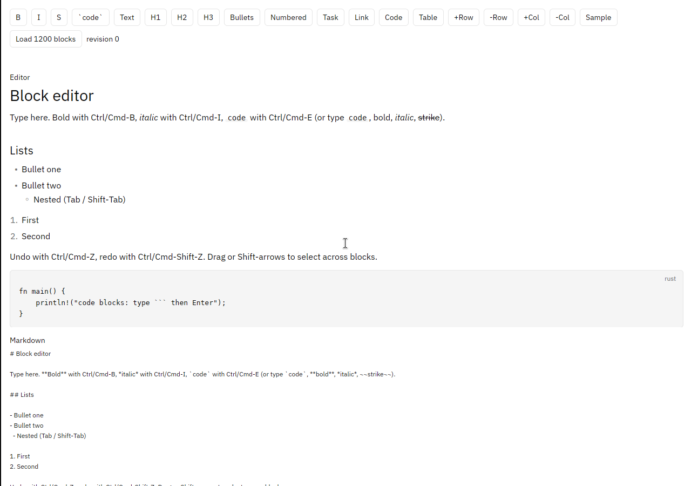

# gpui-kit-markdown-editor

A block-based WYSIWYG Markdown editor for [GPUI](https://www.gpui.rs), built on
[gpui-kit](https://github.com/longbridge/gpui-kit)'s public editor host API
(`gpui_kit::base::text::editor_host`). It edits real Markdown: paragraphs,
headings, nested lists, task lists, block quotes, fenced code blocks, tables,
links, and bold/italic/strike/inline-code marks. It has cross-block selection,
IME, undo/redo, input rules (`# `, `- `, ```` ``` ````), copy/paste as Markdown,
and culling of off-screen blocks.



## Usage

```toml
[dependencies]
gpui-kit = { git = "https://github.com/longbridge/gpui-kit", rev = "45c70d4d7d804f7eb61915f9a303abb2e87da7c3" }
gpui-kit-markdown-editor = { git = "https://github.com/wabzqem/gpui-kit-markdown-editor" }
```

The library is imported as `markdown_editor`.

```rust
use gpui_kit::*;
use markdown_editor::{BlockEditor, BlockEditorEvent, BlockEditorState};

struct Notes {
    editor: Entity<BlockEditorState>,
    scroll: ScrollHandle,
}

impl Notes {
    fn new(window: &mut Window, cx: &mut Context<Self>) -> Self {
        let scroll = ScrollHandle::new();
        let editor = cx.new(|cx| {
            let mut state =
                BlockEditorState::new(window, cx).with_source("# Hello\n\nType **here**.");
            // Optional: keep the caret in view inside your scroll container.
            state.set_scroll_handle(scroll.clone());
            state
        });
        cx.subscribe(&editor, |_, editor, event: &BlockEditorEvent, cx| {
            if let BlockEditorEvent::Changed { .. } = event {
                let _markdown = editor.read(cx).source();
            }
        })
        .detach();
        Self { editor, scroll }
    }
}

impl Render for Notes {
    fn render(&mut self, _: &mut Window, _: &mut Context<Self>) -> impl IntoElement {
        div()
            .id("notes")
            .size_full()
            .overflow_y_scroll()
            .track_scroll(&self.scroll)
            // `min_h_full` makes the whole window clickable, not only the text.
            .child(BlockEditor::new(&self.editor).min_h_full().p_4())
    }
}

fn main() {
    gpui_kit::application().run(|cx| {
        gpui_kit::init(cx);
        markdown_editor::init(cx); // key bindings; call after gpui_kit::init
        gpui_kit::open_window(WindowOptions::default(), cx, |window, cx| {
            cx.new(|cx| Notes::new(window, cx))
        })
        .expect("failed to open window");
    });
}
```

A themed, content-sized wrapper lives in `markdown_editor::component`.

Images load by default. Use `ImagePolicy::Placeholder` to show a placeholder
instead and never resolve URLs, decode data or read paths.

## Features and keys

Cargo features forward to gpui-kit's syntax highlighting for fenced code
blocks; gpui-kit only highlights when one is on:

| Feature | Effect |
| --- | --- |
| `syntect` (default) | About 200 languages, no syntax tree |
| `tree-sitter` | Tree-sitter highlighting (takes precedence if both are on) |

Disable default features to build without highlighting.

Keys (Cmd instead of Ctrl on macOS): Enter, Backspace/Delete, arrows,
Home/End, Ctrl+Home/End (document start/end), Shift to select, Ctrl+A,
Ctrl+B/I/E (bold, italic, code), Ctrl+K (edit link), Ctrl+Z / Ctrl+Shift+Z
(or Ctrl+Y), Ctrl+C/X/V, Ctrl+Shift+V (plain paste), Tab/Shift+Tab (indent
list items, move between table cells), Shift+Enter (soft break, also in a
table cell). Cmd/Ctrl-click a link emits `LinkClicked`; the editor never
opens a browser.

## Known limitations

- Copying across blocks writes Markdown and pastes back as blocks (headings,
  lists, quotes, code, tables, tasks, marks). A table the selection touches is
  copied whole, and a selection starting inside a nested list lifts the nested
  items out instead of copying an empty parent item. Pasting a list directly
  after another list joins them.
- Empty paragraphs have no Markdown form and disappear on save; list
  tightness can change once on the first save, after which output is stable.
- A `BlockEditor` is as tall as its text. Give it `min_h_full()` (and padding
  on the editor, not an outer wrapper) if the whole area should be clickable.
- Accessibility exposes the document as one multi-line text input plus a node
  per laid-out top-level block; nested items, table cells and inline roles are
  not exposed, and screen-reader behaviour is unverified.
- Culling covers top-level blocks and long top-level lists; nested long lists
  and long tables are laid out in full.
- No `source_offset` mapping, no pluggable input-rule registry, and events
  carry no change summaries yet.
- Developed and tested on Linux (under a virtual display). macOS and Windows
  key bindings and IME are implemented but unverified here.
- Bold text only looks bold if the theme font has a bold face (the same as
  gpui-kit's own `TextView`).

## Build and run

Linux needs the same system libraries as gpui-kit
(`script/install-linux.sh` in that repo). Then:

```sh
cargo run --example story
cargo test            # window tests need a display; headless: xvfb-run -a cargo test
```

Everything builds from public dependencies only.

## Design

- [`docs/design.md`](docs/design.md): the editor design.
- [`docs/host-contract.md`](docs/host-contract.md): what the editor needs from the gpui-kit host API.
- [`docs/design-notes.md`](docs/design-notes.md): implementation notes from the spike.

## History and credits

The code began as the block editor spike in gpui-kit
([#3049](https://github.com/longbridge/gpui-kit/pull/3049),
[#3566](https://github.com/longbridge/gpui-kit/pull/3566)); its commit history
is preserved in this repository.

## Licence

Apache-2.0, the same as gpui-kit. See [LICENSE-APACHE](LICENSE-APACHE).
